# Pocket Touchpad · 口袋触控板

[English](README.md) | **简体中文**

把 iPhone 变成 Mac 的触控板和键盘。

Pocket Touchpad 是一套原生 iPhone 应用与 Mac 接收端。竖屏时用一只手移动、点击和拖移；横屏时左右两块触摸区让两只手共同操作。需要打字时，点一下调出手机的系统键盘。

界面围绕大面积触摸区、两排独立按钮和四个自定义快捷键展开，支持浅色与深色。手机与 Mac 在本地网络配对连接。

原生 SwiftUI · iPhone + Mac · iOS 26+ / macOS 26+ · 开发预览版

**允许用于商业作品与工作；禁止将本项目源码或修改版做成商业产品或服务。** 许可详情见 [LICENSE](LICENSE) 与[中英文许可声明](docs/OPEN_SOURCE.md)。

## 截图

### 竖屏：浅色与深色

两排独立按钮，大面积触摸区放在下方。

  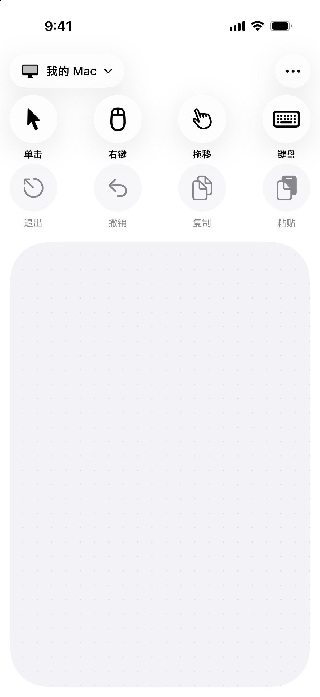
  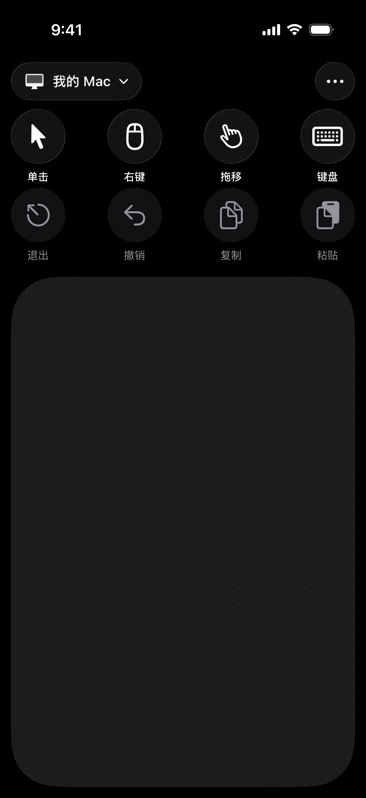

### 横屏：左右两只手一起操作

左右触摸区占满两侧高度，功能按钮集中在中间。浅色与深色均直接展示。

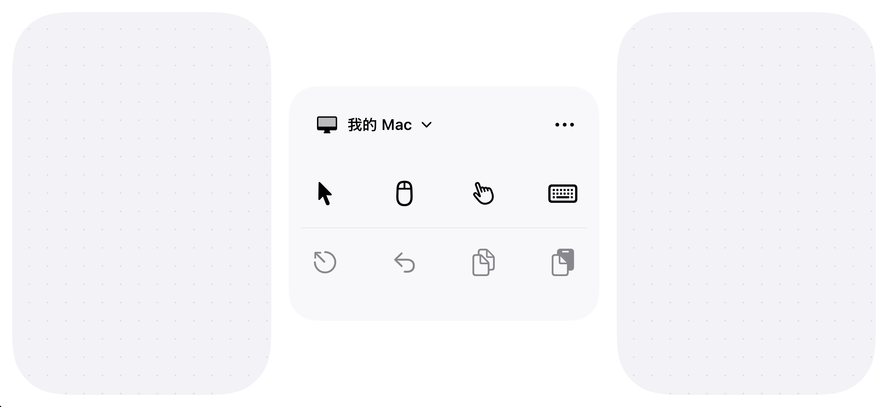

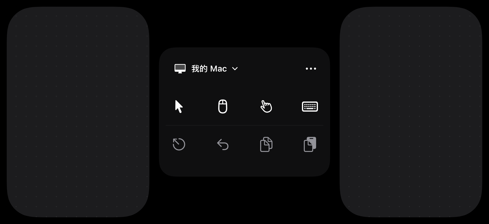

### 拖移：亮起就是按住

拖移键高亮时保持鼠标左键，抬手换位也不会放开；再点一次释放。

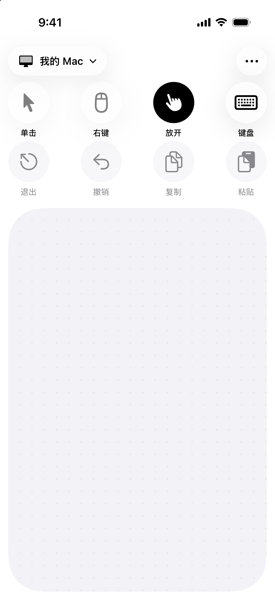

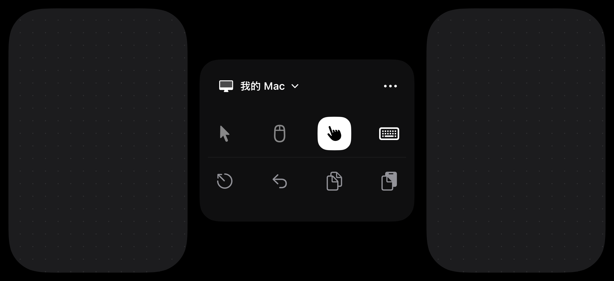

### 键盘：直接用手机的输入法

编辑文字、选词完成后点发送。Tab、退格和回车都有独立按钮。

  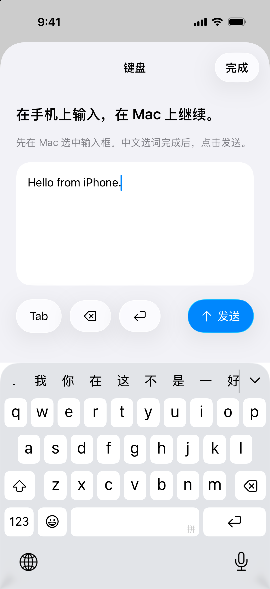
  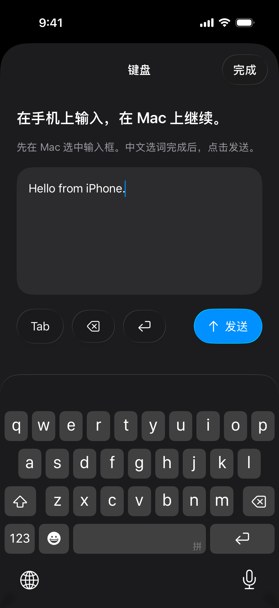

### 布局：给拇指留出合适的位置

编辑模式显示触摸区缩放手柄和快捷键位置；设置页提供尺寸滑块与四个自定义按钮选项。

  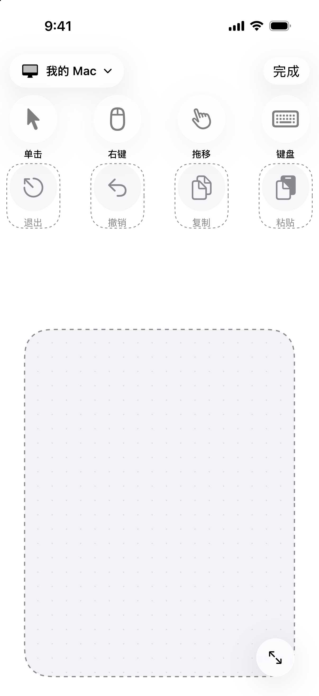
  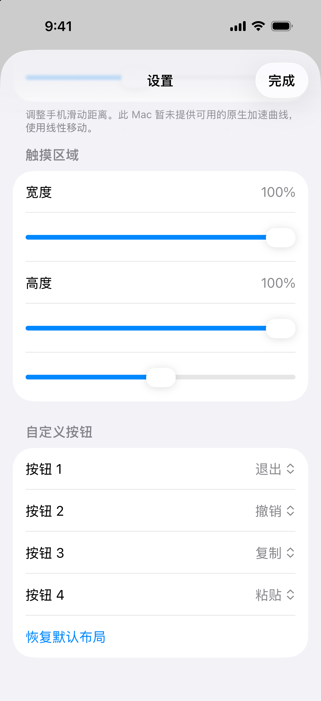

### 连接与手势设置

通过保存的记录重连 Mac，或扫码配对。设置中说明各手势的操作方式与兼容范围。

  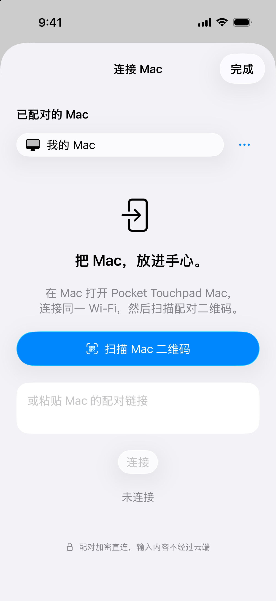
  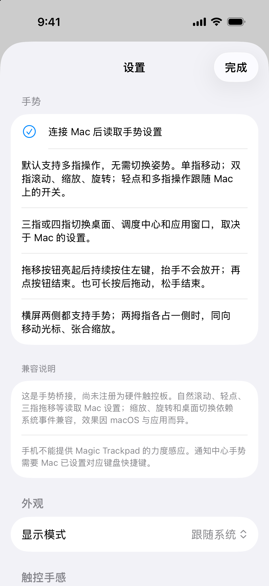

以上 12 张均为实际 SwiftUI 应用的 iPhone 模拟器截图。连接状态与已配对 Mac 记录使用离线演示数据，没有连接真实 Mac，也没有展示配对凭据；截图不代表实机延迟或触觉表现。

## 当前能做什么

- **移动和点击：** 单指相对移动，像普通触控板一样抬手换位，按 Mac 的显示器排列跨屏；支持单击、双击、右键。
- **拖移和多指手势：** 点亮拖移按钮后滑动，抬手换位仍保持拖移，再点一次放开。支持滚动、惯性、缩放、旋转，以及按系统设置与兼容能力启用的多指手势。
- **横屏双手操作：** 左右两块触摸区都能移动光标，两拇指同向移动、张合缩放；功能按钮集中在中间。
- **用手机输入：** 调出 iPhone 系统键盘，完成中文选词或 Emoji 输入后点“发送”，传到 Mac 当前输入位置。另有 Tab、回车和退格。
- **调整自己的布局：** 四个自定义快捷键；竖屏可调整按钮位置、触摸区大小。支持浅色、深色与跟随系统。
- **记住你的 Mac：** 局域网扫码配对，保存连接记录，前台恢复时尝试自动重连。连接使用 TLS-PSK 加密，配对密钥保存在系统钥匙串。

完整手势与限制见 [手势说明](docs/Gestures.md)。无需注册账户或云端中转，也不安装内核扩展。

## 构建与使用

应用名称为 **Pocket Touchpad（口袋触控板）**；Xcode 工程及 Scheme 沿用开发名称 `Touchpad` 和 `TouchpadMac`。

1. 用 **Xcode** 打开 `Touchpad.xcodeproj`。当前开发与编译使用 **Xcode-beta**，需要支持对应 SDK。
2. 在 **Touchpad** 和 **TouchpadMac** 两个 Target 的 Signing & Capabilities 中选择自己的开发团队，必要时设置唯一的 Bundle Identifier。
3. 选择 **TouchpadMac** Scheme，运行到 Mac，按提示允许辅助功能控制。
4. 选择 **Touchpad** Scheme，运行到 iPhone。按系统提示处理开发者模式。
5. 两端加入同一局域网，在手机允许本地网络权限，扫描 Mac 接收端的配对二维码。
6. 在 Mac 选中需要操作的应用或输入框，用手机移动、点击和发送文字。

详细步骤与权限排查见 [安装说明](docs/Setup.zh-CN.md)。目前没有 App Store 版本，也未提供面向公众的已签名发行包。

## 已知限制

Pocket Touchpad 是软件输入桥接，没有注册成硬件 Magic Trackpad。部分高级手势与原生加速依赖 macOS 私有接口，系统更新可能影响兼容性；Force Click、压力分级、防掌误触以及所有应用的自定义手势尚未等价实现。

iOS 锁屏或后台可能暂停网络，应用回到前台会检测并尝试重连，不保证永久后台在线。键盘采用“编辑后发送”，当前不读取 Mac 屏幕或剪贴板。真实无线延迟和不同应用的手势效果仍需实机验证。

## 许可与贡献

本项目采用 **[Pocket Touchpad Source-Available License 1.0](LICENSE)**（项目专用许可）。

- **允许：** 用 Pocket Touchpad 做商业设计、视频、软件、收费委托或企业内部工作；也可修改后用于内部工作流。自己的独立成果可出售或交付，不因使用 Pocket Touchpad 而被要求开源、署名或付费。
- **不允许：** 出售本项目源码或修改版、提供收费安装包或订阅，或把其代码、功能集成进商业产品和服务。
- **分享：** 可免费分享非商业 fork 和编译版本，需保留 [LICENSE](LICENSE)、[NOTICE](NOTICE) 与适用的第三方声明。

本项目属于 **source-available（源码公开）**，不宣称采用标准开源许可证。第三方材料继续适用原有许可，见 [ThirdPartyNotices.txt](docs/ThirdPartyNotices.txt)。完整边界与中英文例子见 [许可声明](docs/OPEN_SOURCE.md)。

欢迎提交问题与改进，参见 [贡献说明](CONTRIBUTING.md)。请勿提交配对二维码、配对链接、密钥、签名证书或个人设备数据。
